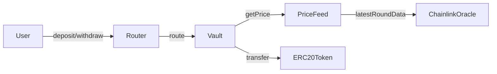

# HiAuditAgent Architecture

Comprehensive architecture mapping that visualizes contract relationships, inheritance hierarchies, and inter-contract dependencies. Produces actionable diagrams and summaries that serve as the foundation for focused security reviews.

## When to Activate

- User asks about project structure or architecture
- User wants to understand inheritance hierarchy
- User asks about contract dependencies or relationships
- User wants to map inter-contract communication
- User asks "how are these contracts connected?"
- Starting a new audit and need a structural overview

## When NOT to Use

- User wants a full security audit (→ hiauditagent-analyzer)
- User wants to understand a specific function (→ hiauditagent-explainer)
- User wants full project onboarding with threat model (→ hiauditagent-overview)
- User wants storage layout (→ hiauditagent-storage)

## Available MCP Tools

1. **hiauditagent_scan** - Upload source and return the remote audit report
   - `path`: File or directory to upload (optional, defaults to current)
   - Use the report plus source reading to map architecture, inheritance, and permissions.

## Process

### Step 1: Generate the Inheritance Graph

```
1. Run hiauditagent_scan(), then read contract files to build the inheritance graph
2. Identify:
   - Core contracts (concrete implementations with business logic)
   - Base contracts (abstract/inherited foundations)
   - Interfaces (API boundaries)
   - Libraries (stateless utility code)
3. Note the inheritance depth and breadth
4. Flag diamond inheritance (multiple inheritance paths to same base)
```

### Step 2: Contract Classification

Classify each contract by its role in the system:

| Role | Description | Examples |
|------|------------|---------|
| **Entry Point** | User-facing, receives transactions | Router, Vault, Token |
| **Core Logic** | Business logic, state management | LendingPool, AMM |
| **Access Control** | Permission management | Ownable, AccessControl |
| **Storage** | Data structures, state layout | Storage contracts in diamond |
| **Utility** | Stateless helpers | Math libraries, SafeERC20 |
| **Interface** | API definition, no implementation | IERC20, IVault |
| **Proxy** | Delegation, upgradeability | TransparentProxy, UUPS |

### Step 3: Summarize Key Contracts

For each core/entry-point contract:
```
1. Run hiauditagent_scan if needed, then summarize contract Name from source
2. Document:
   - Purpose and role in the system
   - Full inheritance chain (C3 linearization)
   - Key state variables (especially those handling value)
   - External/public functions (the attack surface)
   - Modifiers used (the security boundaries)
   - Events (for understanding state change tracking)
```

### Step 4: Map Inter-Contract Communication

```
1. For key functions, run hiauditagent_scan if needed, then trace callers and callees of name in source
2. Map which contracts call which:
   - Direct calls (contract.function())
   - Inherited calls (super.function())
   - Library calls (LibName.function())
   - Interface calls (IERC20(addr).transfer())
3. Identify trust boundaries in cross-contract calls
```

### Step 5: Identify Architectural Patterns

| Pattern | What to Look For | Security Implications |
|---------|-----------------|----------------------|
| **Proxy/Upgradeable** | ProxyAdmin, UUPS, TransparentProxy | Storage layout collisions, uninitialized impl |
| **Diamond (EIP-2535)** | DiamondCut, Facets, Loupe | Storage namespace collisions, selector clashes |
| **Factory** | Clone, create2, minimal proxy | Initialization races, address prediction |
| **Router** | Central dispatcher, multicall | Input validation at entry vs. internal |
| **Vault (ERC-4626)** | Deposit/withdraw/share math | First depositor, rounding, donation attacks |
| **Governance** | Propose/vote/execute/timelock | Flash loan voting, quorum manipulation |
| **Oracle** | PriceFeed, TWAP, Chainlink | Staleness, manipulation, fallback |
| **Bridge** | Message passing, lock/mint | Replay, censorship, liveness |

### Step 6: Dependency Analysis

```
External dependencies:
1. List all imported libraries with versions
   - OpenZeppelin: which version? Pinned or floating?
   - Chainlink: which interfaces?
   - Uniswap: V2, V3, V4?
2. Check for known vulnerabilities in dependency versions
3. Note any forked/modified library code
4. Flag floating pragma versions (^0.8.0 vs =0.8.20)
```

## Output Format

```markdown
# Architecture: [Project Name]

## Overview
[2-3 sentences: what this project does and its core architecture pattern]

## Contract Graph

```mermaid
[Mermaid diagram of contract inheritance built from source after hiauditagent_scan]
```

## Contract Inventory

| Contract | Type | Role | Inherits | Functions | Lines |
|----------|------|------|----------|-----------|-------|
| Vault | contract | Core/Entry | ERC4626, Ownable2Step, ReentrancyGuard | 15 | 350 |
| Router | contract | Entry | Ownable | 8 | 120 |
| PriceFeed | contract | Oracle | AggregatorV3Interface | 5 | 80 |
| IVault | interface | API | - | 10 | 40 |
| MathLib | library | Utility | - | 6 | 60 |

## Inheritance Chains

### Vault
```
Vault → ERC4626 → ERC20 → IERC20
     → Ownable2Step → Ownable
     → ReentrancyGuard
     → Pausable
```

### Router
```
Router → Ownable
```

## Key Cross-Contract Communication



## Architectural Patterns Identified

- **Proxy:** UUPS (Vault is upgradeable via UUPSUpgradeable)
- **Oracle:** Chainlink with no fallback (single point of failure)
- **Token:** Standard ERC20 with SafeERC20 wrappers

## External Dependencies

| Library | Version | Pinned | Modified |
|---------|---------|--------|----------|
| OpenZeppelin | v4.9.3 | Yes | No |
| Chainlink | v0.8 | Yes | No |
| Solmate | v6.2.0 | Yes | No |

## Audit Priority (Architecture-Based)

| Priority | Contract | Reason |
|----------|----------|--------|
| 1 | Vault.sol | Core logic, handles all value, upgradeable |
| 2 | Router.sol | Entry point, input validation boundary |
| 3 | PriceFeed.sol | External dependency, no fallback |
| 4 | MathLib.sol | Used by Vault, precision-critical |
```

## After Architecture Mapping

Offer:
- "Want me to deep-dive into [highest-priority contract]?" (→ hiauditagent-analyzer)
- "Want me to check the storage layout for upgrade safety?" (→ hiauditagent-storage)
- "Want me to map the access control model?" (→ hiauditagent-access)
- "Want me to build a full threat model?" (→ hiauditagent-overview)

## Rationalizations to Reject

| Rationalization | Why It's Wrong |
|-----------------|----------------|
| "I can see the file structure, no need for the tool" | File names don't reveal inheritance, cross-contract calls, or hidden dependencies. Use the tools. |
| "Standard OpenZeppelin contracts don't need mapping" | Understanding the full inheritance chain reveals modifier resolution order and potential overrides. |
| "The architecture is simple, one contract" | Even simple contracts inherit from multiple bases. Map the full chain. |
| "Libraries are safe, just utility code" | Libraries with `using for` can subtly change behavior. Map their usage and verify correctness. |
| "I'll look at the interesting contracts and skip the rest" | Architecture analysis covers ALL contracts. Peripheral contracts can introduce vulnerabilities. |
| "The diagram is self-explanatory" | Interpret the diagram. Identify patterns, anomalies, and security implications explicitly. |
| "External dependencies are trusted" | Dependencies have versions, known CVEs, and can be modified. Always verify and document. |
| "I already know this pattern" | Every implementation is different. Map THIS specific architecture, not a generic pattern. |
